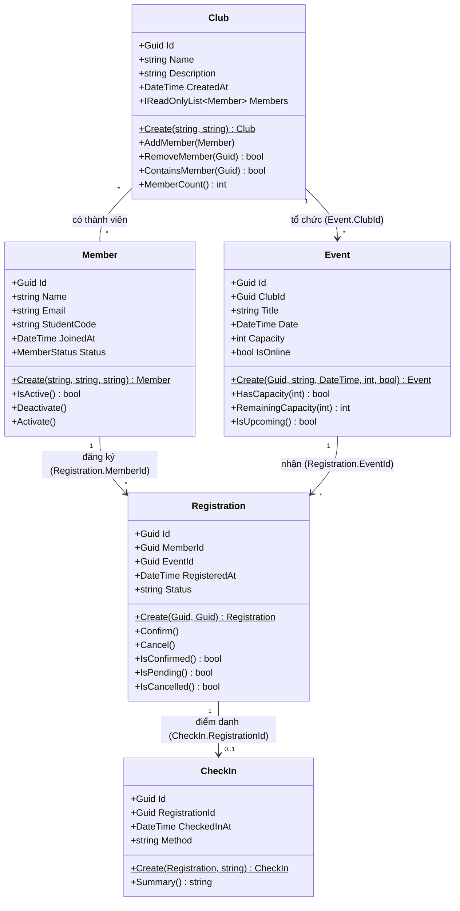

# Sơ đồ lớp sơ bộ — EduHub

Sơ đồ lớp 5 entity chính của hệ thống EduHub (Member, Club, Event, Registration, CheckIn) thể hiện thuộc tính, phương thức hành vi, các khoá ngoại (FK) và mối quan hệ.

---

## 1. Hình ảnh Sơ đồ lớp

---

## 2. Sơ đồ dạng Mermaid

